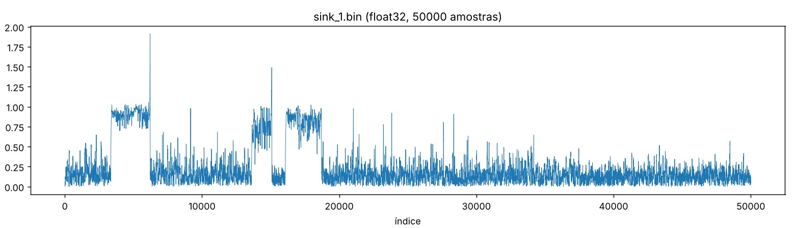
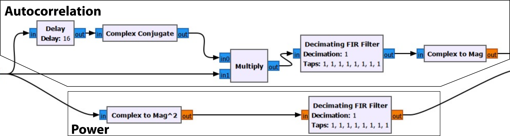

# First Week

## 1. 802.11a OFDM system design parameters
 
| Parameter | Value |
|---|---|
| Bandwidth | 20 MHz |
| Sub-carrier spacing | 312.5 kHz |
| IFFT/FFT size | 64 |
| Data sub-carriers | 48 |
| Pilot sub-carriers | 4 |
| Sampling rate | 20 Msps |
| OFDM symbol duration | 4 µs |
| OFDM symbol length | 80 samples |
| Cyclic prefix length | 16 samples (0.8 µs) |
 
**Why are there unused sub-carriers, and where are they?**
Of the 64 sub-carriers, 12 are unused. One is the DC sub-carrier in the centre, left empty because of DC offset in the receiver. The other 11 are guard bands at the edges of the channel, which reduce interference with neighbouring channels and make filtering easier.
 
**Frame preamble:**
- Short training sequence: a 16-sample symbol repeated 10 times (160 samples, 8 µs).
- Long training sequence: a 64-sample symbol repeated 2.5 times, i.e. a 32-sample guard interval plus 2 symbols (160 samples, 8 µs).
- Total: 320 samples, 16 µs.
## 2. Section 2.1: tags
 
Tags are labels attached to specific samples in the stream. The frame-sync blocks tag the start of each frame, and the equalizer uses that tag to count symbols. The SIGNAL-field decoder tags the stream with the frame's encoding and length, and the MAC decoder reads it.
 
## 3. Section 2.2: frame detection
 
**Blocks that calculate the autocorrelation:** Delay (16 samples), Complex Conjugate, Multiply, a Moving Average filter, and Complex to Mag.
 
**Blocks that calculate the power:** Complex to Mag² and a Moving Average filter.
 
The Divide block then divides the autocorrelation by the power. OFDM Sync Short detects a frame when this ratio stays above 0.8.
 

